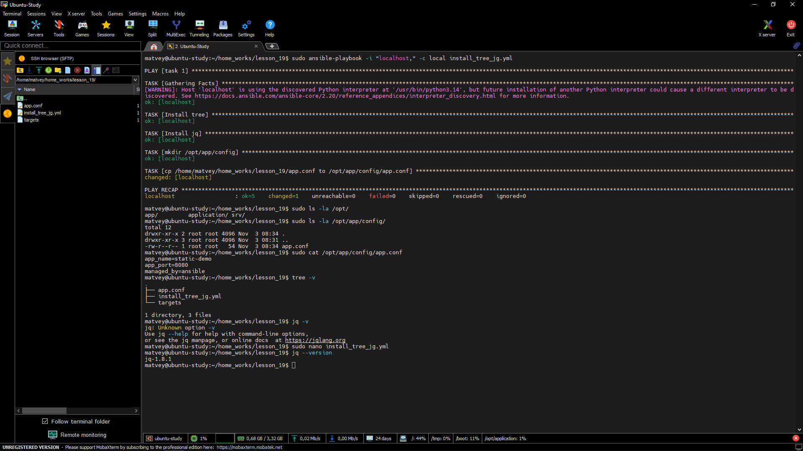
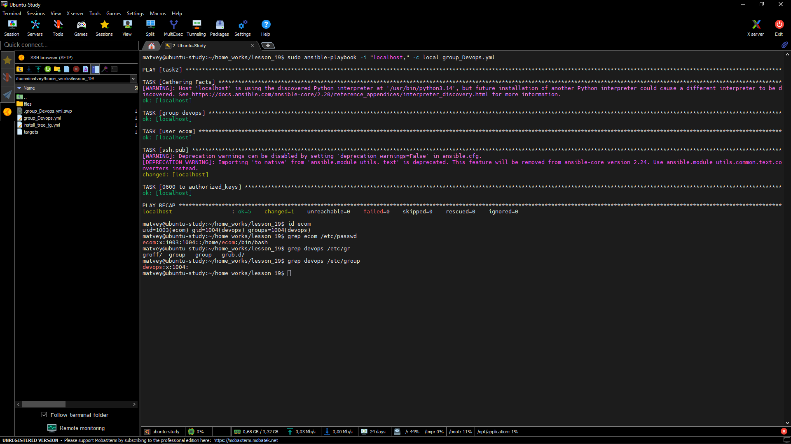
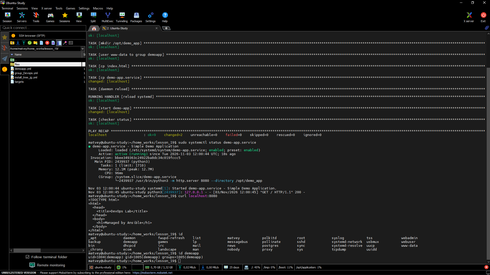

1) Написать плейбук, который:
   
   <br>- Устанавливает пакеты tree и jq;</br>
   <br>- Создаёт директорию /opt/app/config;</br>
   <br>- Копирует files/app.conf в /opt/app/config/app.conf (содержимое app.conf https://github.com/anestesia001/static-demo-app/blob/main/app.conf);</br>
   <br>- Устанавливает права 0644;</br>
   
 ```
- name: task 1
  hosts: all
  become: true


  tasks:
    - name: Install tree
      ansible.builtin.apt:
        name: tree
        state: latest
        update_cache: true

    - name: Install jq
      ansible.builtin.apt:
        name: jq
        state: latest
        update_cache: true


    - name: mkdir /opt/app/config
      ansible.builtin.file:
        path: /opt/app/config
        state: directory
        mode: '0755'


    - name: cp /home/matvey/home_works/lesson_19/app.conf to /opt/app/config/app.conf
      ansible.builtin.copy:
        src: /home/matvey/home_works/lesson_19/app.conf
        dest: /opt/app/config/app.conf
        mode: '0644'
```


2) Написать плейбук, который:

   <br>- Создаёт группу devops;</br>
   <br>- Создаёт пользователя ecom: shell — /bin/bash; домашняя директория — /home/ecom; пользователь входит в группу devops;</br>
   <br>- Создаёт директорию /home/ecom/.ssh с правами 0700;</br>
   <br>- Создаёт файл /home/ecom/.ssh/authorized_keys;</br>
   <br>- Вставляет в authorized_keys публичный SSH-ключ, который лежит в файле files/ecom_key.pub;</br>
   <br>- Устанавливает владельца ecom и права 0600 на authorized_keys;</br>
  
 ```
 - name: task2
   hosts: all
   become: true


   tasks:
     - name: group devops
       ansible.builtin.group:
         name: devops
         state: present


     - name: user ecom
       ansible.builtin.user:
         name: ecom
         shell: /bin/bash
         home: /home/ecom
         group: devops
         state: present


     - name: ssh.pub
       ansible.posix.authorized_key:
         user: ecom
         state: present
         key: "{{  lookup('file', 'files/ecom_key.pub')  }}"
         path: /home/ecom/.ssh/authorized_keys
         manage_dir: true


     - name: 0600 to authorized_keys
       ansible.builtin.file:
         path: /home/ecom/.ssh/authorized_keys
         owner: ecom
         group: devops
         mode: '0600'
         state: file

```


3) Написать плейбук, который:
   
   <br>- Создаёт пользователя demoapp без возможности входа по паролю;</br>
   <br>- Создаёт директорию /opt/demo_app с владельцем demoapp;</br>
   <br>- Копирует index.html (https://github.com/anestesia001/static-demo-app/blob/main/index.html) в /opt/demo_app/index.html;</br>
   <br>- Копирует unit-файл (https://github.com/anestesia001/static-demo-app/blob/main/demo-app.service) в /etc/systemd/system/demo-app.service;</br>
   <br>- Выполняет systemctl daemon-reload;</br>
   <br>- Включает и запускает сервис demo-app;</br>
   <br>- Выполняет проверку через curl;</br>
   
```
- name: task3
  hosts: all
  become: true


  tasks:
    - name: user demoapp
      ansible.builtin.user:
        name: demoapp
        shell: /usr/sbin/nologin
        password: '!'
        state: present

    - name: mkdir /opt/demo_app
      ansible.builtin.file:
        path: /opt/demo_app
        state: directory
        owner: demoapp
        group: demoapp
        mode: '0755'


    - name: user www-data to group demoapp
      ansible.builtin.user:
        name: www-data
        groups: demoapp
        append: true


    - name: cp index.html
      ansible.builtin.copy:
        src: files/index.html
        dest: /opt/demo_app/index.html
        owner: demoapp
        group: demoapp
        mode: '0644'


    - name: cp demo-app.service
      ansible.builtin.copy:
        src: files/demo-app.service
        dest: /etc/systemd/system/demo-app.service
        owner: root
        group: root
        mode: '0644'
      notify: reload systemd

    - name: daemon reload
      ansible.builtin.meta: flush_handlers


    - name: start demo-app
      ansible.builtin.systemd:
        name: demo-app.service
        enabled: true
        state: started


    - name: checker status
      ansible.builtin.uri:
        url: http://localhost:8080
        return_content: true


  handlers:
    - name: reload systemd
      ansible.builtin.systemd:
        daemon_reload: true
```



